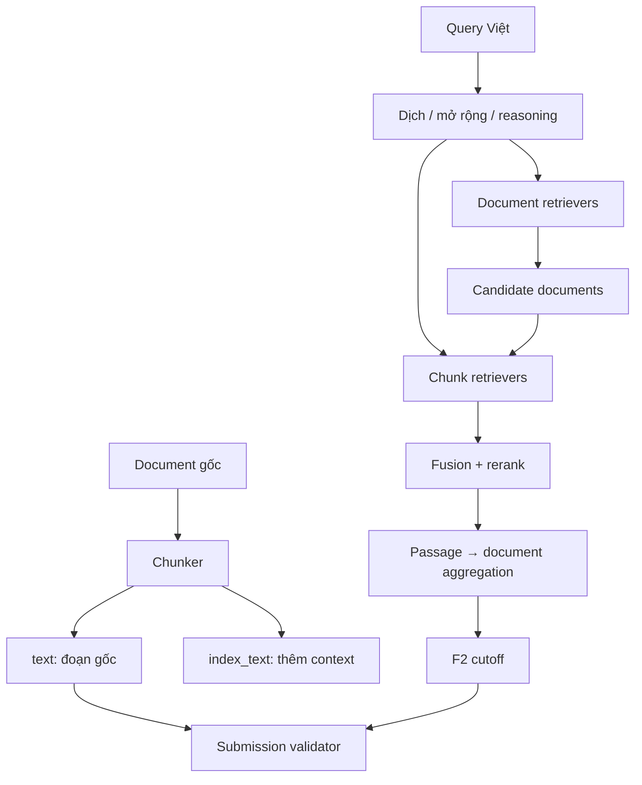

# ViBioMIR Lab

Codebase thử nghiệm retrieval cho R2AI2026/ViBioMIR: 1.2M trang y sinh bằng tiếng Việt, Anh và Trung; đầu ra gồm cả `doc_id` và đoạn văn gốc.

Mục tiêu của repo là thay từng khối bằng YAML để chạy ablation. Baseline nhẹ chạy chỉ với `numpy` và `PyYAML`; model GPU được nạp lười qua optional dependencies.

## Chạy nhanh

```bash
python -m venv .venv
source .venv/bin/activate
pip install -e .

vibiomir run \
  --config configs/experiments/00_bm25_dual_level.yaml \
  --corpus examples/corpus.jsonl \
  --queries examples/queries.jsonl \
  --output runs/demo/submission.json \
  --set chunking.min_tokens=1

vibiomir validate \
  --submission runs/demo/submission.json \
  --corpus examples/corpus.jsonl

vibiomir evaluate \
  --predictions runs/demo/submission.json \
  --gold examples/gold.json
```

Chạy test không cần cài `pytest`:

```bash
PYTHONPATH=src python -m unittest discover -s tests -v
```

## Luồng dữ liệu



`Chunk.text` luôn là substring của trang đã crawl. `Chunk.index_text` có thể chứa title, context hoặc representation khác để retrieval. Submission chỉ ghi `Chunk.text`, nhờ vậy không vô tình nộp summary hoặc đoạn do LLM tạo.

## Cấu trúc

```text
src/vibiomir/
├── chunking/       fixed, sentence, recursive, contextual
├── query/          identity, synonym, NLLB, local-LLM expansion
├── indexing/       SQLite artifact store, Qdrant/impact/PLAID export
├── retrieval/      BM25, Qdrant dense, BGE-M3, SPLADE, ColBERTv2, Late Chunking
├── fusion/         weighted RRF, normalized CombSUM
├── reranking/      identity, HF classifier, BGE-M3 multi-vector, Qwen3
├── aggregation/    MaxP, top-k mean, log-sum-exp
├── selection/      threshold, adaptive score gap, lexical MMR
├── pipeline/       document→chunk cascade và chunk-first
├── evaluation/     normalization, LCS overlap, macro F2
└── io/             JSONL/parquet/Hugging Face input, writer và validator
```

Chi tiết interface: [`docs/architecture.md`](docs/architecture.md). Bảng kiểm chứng paper/source: [`docs/source_map.md`](docs/source_map.md). Hướng dẫn full-corpus: [`docs/full_pipelines.md`](docs/full_pipelines.md).

## Config và override

Config experiment kế thừa `configs/base.yaml`. Có thể đổi tham số mà không tạo file mới:

```bash
vibiomir show-config \
  --config configs/experiments/08_f2_adaptive_cutoff.yaml \
  --set chunking.max_tokens=256 \
  --set retrieval.chunk_pool=1000
```

Các config trong `configs/experiments/` là ablation in-memory trên subset. Chúng không được
coi là reproduction paper. Chín pipeline full-corpus, đã tách index và source audit, nằm trong
`configs/full/`:

| Config full | Phương pháp |
|---|---|
| `00_bm25_lucene` | BM25/Lucene |
| `01_mgte_dense` | mGTE + multilingual reranker |
| `02_bge_m3` | dense + learned sparse + exact three-view candidate rerank |
| `03_medcpt_en` | NLLB → English MedCPT |
| `04_bmretriever_en` | NLLB → English BMRetriever |
| `05_qwen3` | Qwen3 embedding + reranker |
| `06_colbertv2_en` | NLLB → ColBERTv2/PLAID |
| `07_splade_v2_en` | NLLB → SPLADE++ impact index |
| `08_late_chunking_en` | NLLB → Jina Late Chunking |

Kế hoạch chạy baseline theo pha và ablation: [`docs/experiment_guide.md`](docs/experiment_guide.md).

## Dữ liệu đầu vào

Corpus có thể là JSONL, một file/thư mục parquet, hoặc một file parquet tải trực tiếp từ Hugging
Face Dataset. Ví dụ JSONL:

```json
{"id":"583","url":"https://...","title":"...","language":"vi","text":"nội dung sạch nhưng giữ nguyên ký tự gốc"}
```

Query dùng JSONL:

```json
{"id":1,"language":"vi","text":"Câu hỏi y sinh..."}
```

Pilot crawler trên URL chính thức, lưu HTML mẫu và sinh báo cáo extractor:

```bash
pip install -e '.[ingest]'
export VIBIOMIR_CRAWLER_CONTACT='email-cua-doi@example.com'
bash scripts/ingest_all.sh pilot
```

Sau khi xem `data/interim/pilot/html_audit.csv`, chạy từng stage có khả năng resume:

```bash
bash scripts/ingest_all.sh pubmed
bash scripts/ingest_all.sh crawl
bash scripts/ingest_all.sh wayback
bash scripts/ingest_all.sh merge
```

Crawler không dùng LLM: HTTP + CSS rule + trafilatura giữ nội dung nguyên văn. PubMed đi qua
E-utilities; trang chết/bị chặn đi qua Wayback nếu có bản lưu. Xem chi tiết tại
[`docs/data_ingestion.md`](docs/data_ingestion.md).

Để build một pipeline đầy đủ trên 1,2M documents/chunks:

```bash
bash scripts/build_vibiomir_method.sh 01_mgte_dense
bash scripts/run_method.sh 01_mgte_dense \
  data/raw/official/query.parquet path/to/dev_gold.json
```

`build_vibiomir_method.sh` đã pin dataset
[`vibiomir-corpus/vibiomir-corpus`](https://huggingface.co/datasets/vibiomir-corpus/vibiomir-corpus)
ở commit `13d60924d53e720a7f84c78e3b08b7e17b670b5d`, tải đủ 13 shard, xác minh
1.220.598 source rows và chỉ index 1.047.415 tài liệu có text. `run_method.sh` tạo đồng thời
`submission.json`, metrics nếu có gold, và `submission.zip` đúng định dạng BTC. Xem
[`docs/huggingface_corpus.md`](docs/huggingface_corpus.md).

`store.sqlite` giữ chunk gốc để dựng submission và kiểm tra substring. Các vector dense cùng
payload id/offset/chunk được đẩy vào Qdrant; Lucene/PLAID vẫn dùng cho BM25, learned sparse và
ColBERTv2. BTC không bắt buộc Qdrant Cloud, nhưng các pipeline dense của repo này dùng Qdrant.

Tạo `.env` từ `.env.example` rồi điền secret ở máy chạy (file `.env` đã bị git-ignore):

```bash
cp .env.example .env
# QDRANT_URL=https://<cluster>.cloud.qdrant.io:6333
# QDRANT_API_KEY=<secret>
# QDRANT_COLLECTION_PREFIX=vibiomir
```

Không dán API key vào YAML, shell script hay commit. Mỗi dense method có collection riêng; prefix
cho phép nhiều thí nghiệm dùng chung cluster mà không đè collection của nhau.

## Optional dependencies

```bash
pip install -e '.[dense]'        # SentenceTransformers (Qdrant client là core dependency)
pip install -e '.[bge]'          # BGE-M3 dense/sparse/ColBERT vectors
pip install -e '.[lucene]'       # Pyserini
pip install -e '.[colbert]'       # ColBERTv2/PLAID
pip install -e '.[transformers]' # NLLB và local LLM query expansion
```

Model tải về phải được kiểm tra lại theo luật contest: open weights, giới hạn tham số và ngày phát hành.

