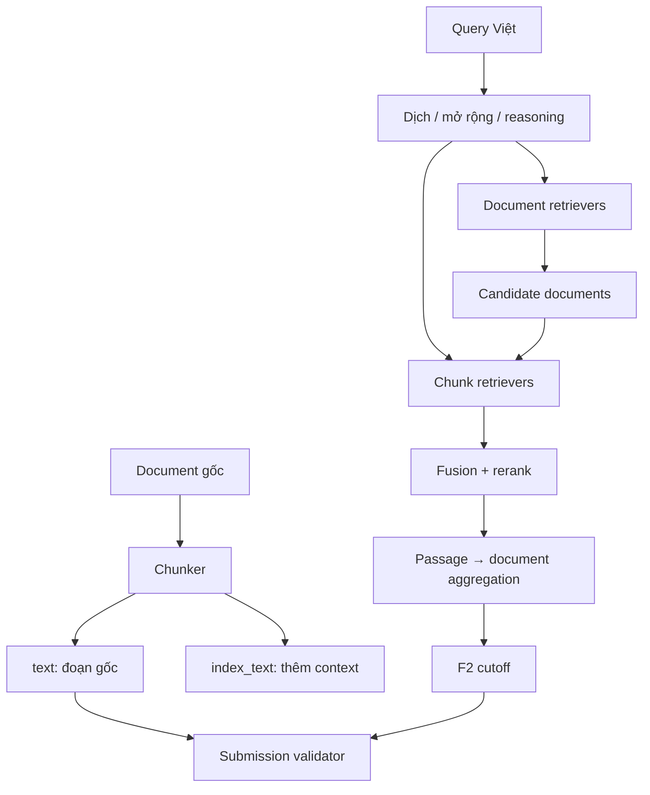

# ViBioMIR Lab

Codebase thử nghiệm retrieval cho R2AI2026/ViBioMIR: 1.2M trang y sinh bằng tiếng Việt, Anh và Trung; đầu ra gồm cả `doc_id` và đoạn văn gốc.

Mục tiêu của repo là thay từng khối bằng YAML để chạy ablation. Baseline nhẹ chạy chỉ với `numpy` và `PyYAML`; model GPU được nạp lười qua optional dependencies.

## Chạy nhanh

```bash
python -m venv .venv
source .venv/bin/activate
pip install -e .

vibiomir run \
  --config configs/experiments/00_bm25_dual_level.yaml \
  --corpus examples/corpus.jsonl \
  --queries examples/queries.jsonl \
  --output runs/demo/submission.json \
  --set chunking.min_tokens=1

vibiomir validate \
  --submission runs/demo/submission.json \
  --corpus examples/corpus.jsonl

vibiomir evaluate \
  --predictions runs/demo/submission.json \
  --gold examples/gold.json
```

Chạy test không cần cài `pytest`:

```bash
PYTHONPATH=src python -m unittest discover -s tests -v
```

## Luồng dữ liệu



`Chunk.text` luôn là substring của trang đã crawl. `Chunk.index_text` có thể chứa title, context hoặc representation khác để retrieval. Submission chỉ ghi `Chunk.text`, nhờ vậy không vô tình nộp summary hoặc đoạn do LLM tạo.

## Cấu trúc

```text
src/vibiomir/
├── chunking/       fixed, sentence, recursive, contextual
├── query/          identity, synonym, NLLB, local-LLM expansion
├── retrieval/      BM25, SentenceTransformer/FAISS, BGE-M3, Pyserini
├── fusion/         weighted RRF, normalized CombSUM
├── reranking/      identity, cross-encoder
├── aggregation/    MaxP, top-k mean, log-sum-exp
├── selection/      threshold, adaptive score gap, lexical MMR
├── pipeline/       document→chunk cascade và chunk-first
├── evaluation/     normalization, LCS overlap, macro F2
└── io/             JSONL, submission writer và provenance validator
```

Chi tiết trách nhiệm và interface: [`docs/architecture.md`](docs/architecture.md). Mapping 26 paper sang code/config: [`docs/source_map.md`](docs/source_map.md).

## Config và override

Config experiment kế thừa `configs/base.yaml`. Có thể đổi tham số mà không tạo file mới:

```bash
vibiomir show-config \
  --config configs/experiments/08_f2_adaptive_cutoff.yaml \
  --set chunking.max_tokens=256 \
  --set retrieval.chunk_pool=1000
```

Các baseline có sẵn:

| Config | Giả thuyết |
|---|---|
| `00_bm25_dual_level` | baseline document→chunk chạy CPU |
| `01_hybrid_multilingual_dense` | BM25 + mGTE + multilingual reranker |
| `02_bge_m3_three_way` | dense + learned sparse + late interaction |
| `03_contextual_mgte` | embedding chunk cùng ngữ cảnh toàn document |
| `04_translate_medcpt` | translate-retrieve + biomedical dual encoder/reranker |
| `05_reasoning_expansion` | GRF/query2doc/BRIGHT query views bằng open LLM |
| `06_late_interaction` | token MaxSim và log-sum-exp document aggregation |
| `07_recursive_chunking` | cấu trúc đoạn thay vì fixed window |
| `08_f2_adaptive_cutoff` | số kết quả biến thiên theo score gap |
| `09_bmretriever_rerank` | biomedical dense retrieval + multilingual reranker |

Kế hoạch chạy baseline theo pha và ablation: [`docs/experiment_guide.md`](docs/experiment_guide.md).

## Dữ liệu đầu vào

Corpus đã crawl dùng JSONL:

```json
{"id":"583","url":"https://...","title":"...","language":"vi","text":"nội dung sạch nhưng giữ nguyên ký tự gốc"}
```

Query dùng JSONL:

```json
{"id":1,"language":"vi","text":"Câu hỏi y sinh..."}
```

Để build Lucene trên 1.2M documents/chunks:

```bash
vibiomir chunk --config configs/experiments/00_bm25_dual_level.yaml \
  --corpus data/processed/corpus.jsonl --output data/processed/chunks.jsonl
bash scripts/build_pyserini_index.sh data/processed/chunks.jsonl artifacts/lucene/chunks
```

Sau đó đổi retriever sang `type: pyserini`, `index_dir: artifacts/lucene/chunks`. Với dense retrieval, đặt `faiss_factory: HNSW32` hoặc một factory IVF phù hợp RAM/latency.

## Optional dependencies

```bash
pip install -e '.[dense]'        # SentenceTransformers, CrossEncoder, FAISS
pip install -e '.[bge]'          # BGE-M3 dense/sparse/ColBERT vectors
pip install -e '.[lucene]'       # Pyserini
pip install -e '.[transformers]' # NLLB và local LLM query expansion
```

Model tải về phải được kiểm tra lại theo luật contest: open weights, giới hạn tham số và ngày phát hành.

